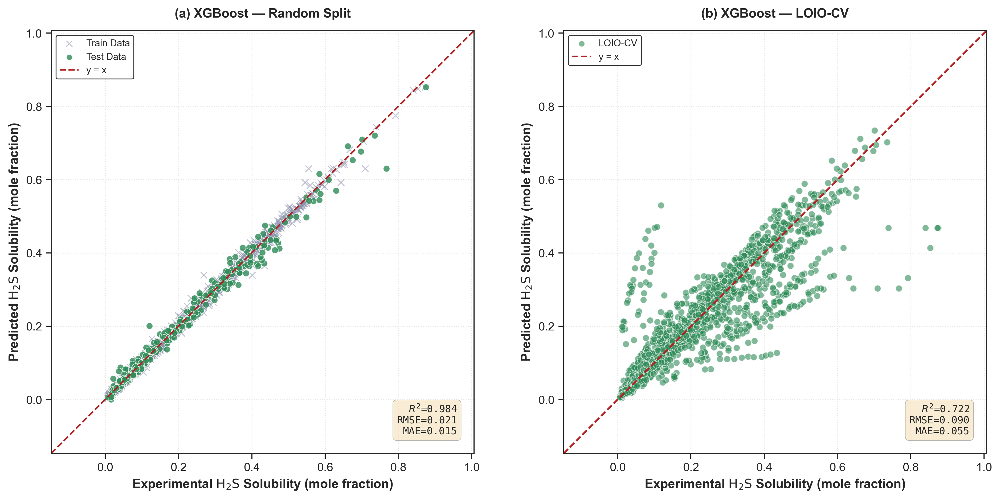

# Extrapolation-aware machine-learning screening of ionic liquids 

面向硫醇前置脱除场景，构建基于H<sub>2</sub>S–IL数据的机器学习预测、外推可靠性评估与候选离子液体虚拟筛选流程。

## 1、项目背景

针对能源气体中硫醇对生物脱硫过程造成的硫颗粒表面疏水化、设备堵塞等问题，本项目提出“离子液体前置吸收 + 数据驱动筛选”的技术路线，用于辅助筛选潜在硫醇吸收剂。

已有研究在4种[C4mim]-based离子液体中对CH<sub>3</sub>SH与H<sub>2</sub>S的溶解行为进行了直接实验比较，结果显示CH<sub>3</sub>SH在这些体系中的溶解度均高于H<sub>2</sub>S。基于这些有限但直接的跨溶质证据，并考虑到硫醇–离子液体实验数据仍较为缺乏，本项目采用数据更丰富的H<sub>2</sub>S–IL体系作为初步代理系统，构建机器学习模型并开展候选离子液体筛选。

项目进一步关注一个核心问题：基于已知离子液体训练得到的模型，能否可靠地泛化到训练集中未出现的新型离子液体体系。因此，在常规随机划分之外，引入LOIO-CV对模型的外推能力和适用边界进行更严格评估。

## 2、核心亮点

- 清洗并构建包含26种离子液体、1,280条H<sub>2</sub>S溶解度数据的数据集，覆盖阴/阳离子结构、温度、压力及溶解度等信息。
- 基于RDKit将阴、阳离子SMILES转化为分子描述符，并与温度(T)、压力(P)共同构建机器学习输入特征。
- 对比Random Split与LOIO-CV，发现四类模型在未见IL场景下均出现不同程度的性能下降，说明常规随机划分可能高估模型的外推性能。
- 构建Leave-One-Ionic-Liquid-Out Cross-Validation(LOIO-CV)验证策略，以整种离子液体为单位留出测试，评估模型对未见IL的泛化能力。
- Streamlit Web 界面：提供“溶解度预测 / 候选离子液体批量筛选 / 外推可靠性评估”三个页面。
- 命令行推理：`python predict.py` 支持全名、简称或 SMILES 输入，可用 `--list` 查看可用离子。
- 四模型集成：XGBoost、随机森林、SVR、GPR 同时预测，输出四模型均值、标准差与极差。
- 可靠性分级：按“内插（组合已知）/ Tier 1（组分已知、组合新）/ 训练集外”三级提示外推风险。
- 构建面向候选IL的可靠性约束虚拟筛选流程，综合化学空间覆盖、LOIO-CV历史表现与多模型预测一致性，对候选离子液体进行排序与分级推荐。

## 3、方法流程

```
Raw experimental data
→ Data cleaning
→ SMILES mapping
→ RDKit molecular descriptors
→ Feature filtering
→ Random Split / LOIO-CV evaluation
→ Final model training
→ Model persistence
→ Virtual screening
→ Reliability assessment
```

## 4、验证策略

随机划分

在常规随机划分中，同一种离子液体在不同温度、压力条件下的多个数据点可能同时出现在训练集和测试集中。此时，模型在测试阶段已经接触过该离子液体对应的结构信息，因此获得的高精度更多反映的是对已知化合物在新工况下的内插（Interpolation）能力，而不能充分代表其对结构未见候选离子液体的外推（Extrapolation）能力。

换言之，随机划分可能使模型部分依赖“已见化合物”的结构模式完成预测，从而对真实的新型IL筛选场景产生偏乐观的性能估计。

LOIO-CV

为更严格评估模型对未知离子液体的泛化能力，本项目采用Leave-One-Ionic-Liquid-Out Cross-Validation(LOIO-CV)。按照离子液体种类进行分组，在每一折中将某一种IL的全部数据点作为测试集，其余\(k-1\)种IL的数据作为训练集，并循环完成\(k\)次验证。

该策略保证测试IL在当前训练折中完全未出现，因此更接近实际虚拟筛选中预测全新候选离子液体的应用场景。

以 XGBoost 为例，其\(R^2\)从随机划分下的0.979降至LOIO-CV下的0.722，说明常规随机划分会明显高估模型对未见IL的外推性能。

## 5、关键结果

| 模型    | 随机划分\(R^2\) | LOIO-CV \(R^2\) | \(R^2\) 落差 | 随机划分 RMSE | LOIO-CV RMSE |
| ------- | --------------- | --------------- | ------------ | ------------- | ------------ |
| XGBoost | 0.9790 ± 0.0057 | 0.7224          | 0.2566       | 0.0242        | 0.0896       |
| RF      | 0.9657 ± 0.0078 | 0.672           | 0.2937       | 0.0309        | 0.0974       |
| SVR     | 0.8845 ± 0.0338 | 0.7292          | 0.1553       | 0.0564        | 0.0885       |
| GPR     | 0.8821 ± 0.0248 | 0.7267          | 0.1554       | 0.0573        | 0.0889       |



## 6、项目结构

```text
project/
├── app.py                     # Streamlit Web 界面（三个页面）
├── predict.py                 # 命令行预测入口
├── data/
│   └── zhao_data.csv          # 清洗后数据集（已跟踪）
├── models/                    # 本地生成资产（*.pkl / *.npy，不提交）
│   ├── vs_models.pkl
│   ├── scaler.pkl
│   ├── nan_cols_mask.npy
│   ├── var_mask.npy
│   └── descriptor_names.npy
├── outputs/                   # 实验结果（已跟踪部分）
│   ├── loio_cv_model_comparison.csv
│   └── loio_cv_XGBoost_per_il.csv
├── src/
│   ├── preprocess.py          # 数据清洗、SMILES 映射、RDKit 描述符与特征矩阵
│   ├── evaluate.py            # Random Split 与 LOIO-CV 评估
│   ├── train.py               # 四模型训练与模型资产持久化
│   ├── inference.py           # 统一推理接口（被 app.py 调用）
│   └── predict.py             # src 版本预测与筛选流程
├── tests/
│   ├── test_inference.py      # 推理接口、可靠分级与批量校验测试
│   └── test_predict.py        # 预测流程基础测试
├── docs/
│   ├── user-manual.md         # 操作手册
│   └── screenshots/           # 系统截图
├── requirements.txt
└── README.md
```

## 7、安装

要求 Python 3.10 及以上（开发环境为 Python 3.13）。

```bash
python -m venv .venv
source .venv/bin/activate        # Windows: .venv\Scripts\activate
python -m pip install -r requirements.txt
```

注：`streamlit` 已包含在 `requirements.txt` 中；模型资产（`models/*.pkl`、`models/*.npy`）未纳入 Git，需按下文流程在本地生成。

## 8、使用说明

### 8.1 启动 Web 界面

```bash
streamlit run app.py
```

浏览器访问 Streamlit 提示的本地地址（默认 http://localhost:8501），可使用“溶解度预测”、“候选离子液体批量筛选”、“外推可靠性评估”三个页面。

### 8.2 命令行预测

```bash
python predict.py --list
python predict.py "C4MIm or BMIM" "TFSI or NTf2" 303.15 1.0
python predict.py BMIM TFSI 303.15 1.0
```

### 8.3 复现实验流程

```bash
python src/preprocess.py   # 清洗数据、构建特征矩阵（需 data/ 下原始 Excel）
python src/evaluate.py     # Random Split 与 LOIO-CV 评估
python src/train.py        # 训练四模型并保存 vs_models.pkl
```

若仅需运行预测与 Web 界面，请确保 `models/` 下已有 `vs_models.pkl`、`scaler.pkl`、`nan_cols_mask.npy`、`var_mask.npy`、`descriptor_names.npy`。

## 9、测试

在项目根目录执行：

```bash
python -m pytest -q
```

注：直接运行 `pytest -q` 可能因 `src` 导入路径问题失败，推荐使用 `python -m pytest -q`。

## 10、文档

- 操作手册：`docs/user-manual.md`
- 系统截图：`docs/screenshots/`
- 依赖清单：`requirements.txt`

## 11、局限性

- 当前训练数据仅覆盖26种离子液体，数据集中大多为[C₄mim]类，模型推广至铵类及其他阳离子骨架可靠性仍受训练化学空间覆盖范围限制。  

- H<sub>2</sub>S–IL数据被用于硫醇吸收剂的初步代理筛选，该代理关系已有有限实验与COSMO-RS计算证据支持，但尚不能视为对所有离子液体体系普遍成立。 

- 虚拟筛选结果用于候选优先级排序，而非证明候选IL在真实体系中的最终性能，仍需进一步实验验证。

