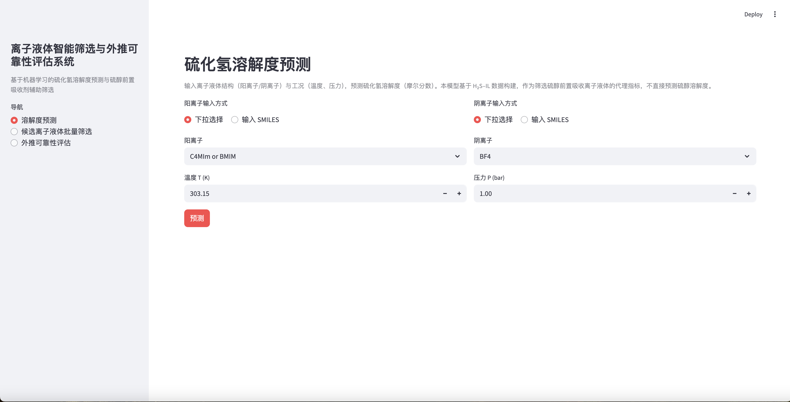
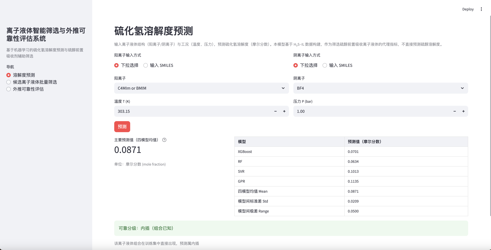
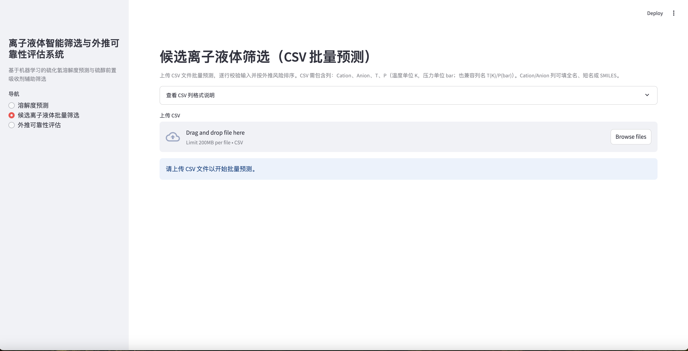
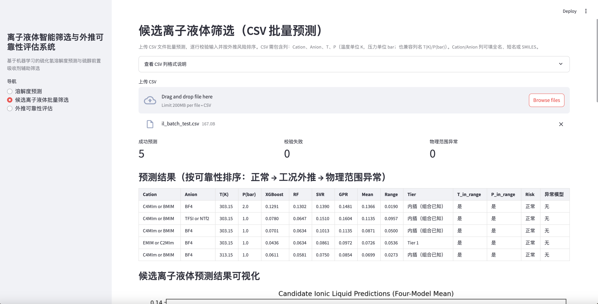
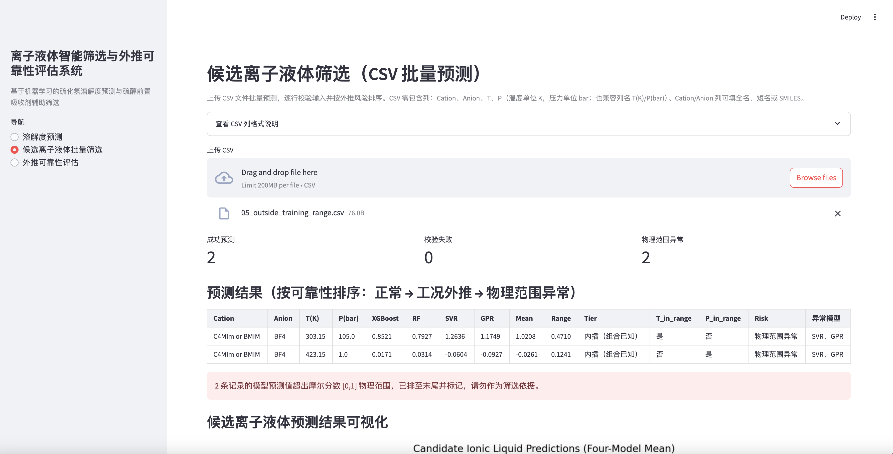
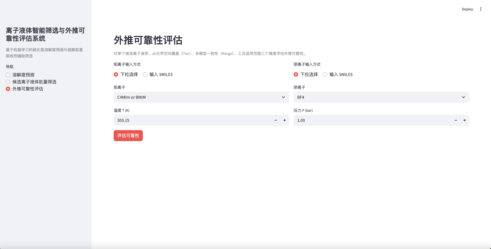
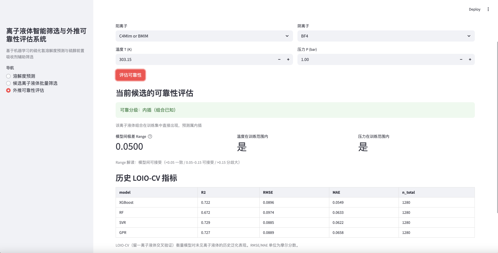

# 离子液体智能筛选与外推可靠性评估系统操作手册

## 一、相关文档

| 文档名称 | 指向资料 | 说明 |
| --- | --- | --- |
| 项目说明 | ../README.md | 说明软件的项目背景、核心方法、验证策略、项目结构与运行方式。 |
| 依赖清单 | ../requirements.txt | 列出软件运行所需的 Python 依赖包及对应版本。 |

## 二、说明

离子液体智能筛选与外推可靠性评估系统 V1.0 面向能源气体脱硫场景，为化工、材料及环境领域的科研人员与研发工程师提供离子液体吸收材料的性能预测、候选初筛与可靠性辅助评价。

软件以数据相对丰富的硫化氢–离子液体溶解度体系作为代理系统，利用机器学习预测离子液体在给定温度、压力工况下的硫化氢溶解度，并将该溶解度作为筛选硫醇前置吸收离子液体的代理指标。需要说明的是，软件直接预测的是硫化氢（H2S）溶解度，并不直接预测硫醇溶解度或硫醇/H2S 选择性。

软件内置 XGBoost、随机森林、支持向量回归与高斯过程回归四类机器学习模型，围绕离子液体的阳离子、阴离子结构与温度、压力工况，提供硫化氢溶解度预测、候选离子液体批量筛选、外推可靠性评估三项核心能力。单点预测支持名称、简称或 SMILES 多种输入方式；批量筛选支持 CSV 文件上传、逐行校验与结果导出；可靠性评估依据离子液体结构覆盖、模型间预测一致性、温度压力训练范围与历史留一离子液体交叉验证（LOIO-CV）表现，辅助识别外推风险，帮助用户在开展实验前缩小候选范围、识别模型适用边界。本系统为科研辅助软件，不用于工业现场验证或直接控制脱硫生产装置。

## 三、功能特点

硫化氢溶解度预测功能用于估算单个候选离子液体对硫化氢的溶解能力。用户输入阳离子、阴离子结构与温度、压力工况后，软件调用四类机器学习模型分别给出预测值，并汇总四模型均值、模型间标准差与极差，同时按该离子液体组合在训练集中的覆盖情况给出可靠分级，作为判断其是否适合作为硫醇前置吸收剂代理的初步依据。

候选离子液体批量筛选功能面向手头已有一批候选清单的场景。用户上传包含阳离子、阴离子、温度、压力列的 CSV 文件后，软件逐行校验输入并批量调用四类模型预测，按四模型均值降序排序展示候选排名，标注每一条记录的外推风险状态，并以柱状图和散点图直观呈现候选之间的预测差异，支持导出预测结果与校验失败记录。

外推可靠性评估功能用于考察单个候选离子液体预测结果的可靠程度。软件从化学空间覆盖（Tier 分级）、多模型一致性（模型间极差 Range）、工况适用范围（温度压力是否落在训练覆盖范围）三个维度给出判断，并展示历史 LOIO-CV 的相关系数、均方根误差、平均绝对误差等指标，供用户参考判断该候选是否值得进入后续实验验证。

## 四、系统要求

| 系统要求 | 最低配置 | 推荐配置 |
| --- | --- | --- |
| 操作系统 | Windows 10、macOS 11 或主流 Linux 发行版 | Windows 11、macOS 13 及以上 |
| 浏览器 | Chrome、Edge、Safari 等现代浏览器 | 最新版 Chrome 或 Edge |
| 运行环境 | Python 3.10 及以上，安装 requirements.txt 依赖 | Python 3.13，独立 conda 环境 |

软件采用浏览器访问的 B/S 方式运行，服务端部署于 macOS 或 Linux，用户通过 Chrome 等现代浏览器访问页面并完成操作。


## 五、启动与访问

在项目根目录执行以下命令启动系统：

```bash
python -m pip install -r requirements.txt
streamlit run app.py
```

服务启动后，在浏览器中访问 Streamlit 提示的本地地址（默认 http://localhost:8501）。
## 六、硫化氢溶解度预测

硫化氢溶解度预测页面用于快速估算某个候选离子液体对硫化氢的溶解能力。用户启动系统后，在左侧导航栏选择“溶解度预测”即可进入该页面。

页面提供阳离子和阴离子两处输入区，每处都可在“下拉选择”与“输入 SMILES”两种方式之间切换。选择下拉方式时，可从训练集离子列表中选择阳离子或阴离子；选择 SMILES 方式时，在文本框内直接输入分子结构字符串。阳离子、阴离子下方是温度与压力两个数值输入框，温度单位为开尔文（K），可输入范围 200–600 K；压力单位为 bar，可输入范围 0.001–200 bar。页面底部的“预测”按钮用于提交本次预测。



操作时，先确定阳离子和阴离子，再输入温度与压力，然后点击“预测”按钮。若输入的 SMILES 无法被解析，页面会提示输入有误；若温度或压力超出模型训练数据覆盖范围（T 293.15–403.15 K，P 0.001–96.3 bar），预测结果属于外推，页面会给出外推警告。预测完成后，页面展示四模型各自的预测值、四模型均值、模型间标准差与极差，并显示可靠分级徽章：内插表示该离子液体组合在训练集中直接出现，Tier 1 表示阴阳离子组分均在训练集出现但该组合未被测量，训练集外表示至少一个离子未在训练集出现。



## 七、候选离子液体批量筛选

候选离子液体批量筛选页面用于一次性预测多个候选离子液体并按溶解度排序。用户手头有一批候选清单时，在左侧导航栏选择“候选离子液体批量筛选”进入该页面。

页面提供 CSV 文件上传控件，并附有列格式说明：CSV 需包含 Cation、Anion、T、P 四列，其中温度单位为 K、压力单位为 bar，Cation 与 Anion 列可填写全名、简称或 SMILES。上传文件后，软件逐行校验输入，将空值、非法 SMILES、非数值以及温度压力小于等于 0 的记录识别出来并单独记录；对校验通过的记录，软件批量调用四类模型预测，并按四模型均值排序展示结果。



预测结果表包含每条记录的阳离子、阴离子、温度、压力、四模型预测值、均值、极差、可靠分级、温度压力是否在训练范围以及风险状态。软件按“正常、工况外推、物理范围异常”三档对结果排序：预测值落在摩尔分数 0–1 物理范围之外或工况超出训练覆盖范围的记录会被标注并排到后面。页面同时用柱状图展示候选排名、用散点图展示预测值与模型间分歧，并提供“导出预测结果 CSV”与“导出校验失败记录 CSV”两个按钮，用户可将结果或失败明细下载保存。





## 八、外推可靠性评估

外推可靠性评估页面用于考察单个候选离子液体预测结果的可靠程度。用户选定某个候选后，在左侧导航栏选择“外推可靠性评估”进入该页面。

页面提供与溶解度预测页相同的阳离子、阴离子输入区和温度、压力输入框，并设有“评估可靠性”按钮。



输入候选离子液体的阳离子、阴离子与温度、压力并点击按钮后，页面展示该候选的可靠分级徽章、四模型预测的极差 Range，以及温度、压力是否落在训练覆盖范围。极差小于 0.05 视为模型间高度一致，0.05–0.15 之间视为可接受，大于 0.15 表示模型间分歧较大、结果需谨慎对待。

页面同时展示历史 LOIO-CV 指标表，列出各模型在留一离子液体交叉验证下的相关系数、均方根误差与平均绝对误差。这些指标反映模型在全体训练数据上的历史泛化表现，用于辅助判断外推风险，不代表当前单个候选的真实预测误差或统计置信概率。



## 九、典型使用流程

用户启动系统后，在左侧导航栏选择功能页面。需要估算单个候选时，进入溶解度预测页面，选择或输入阳离子、阴离子结构，输入温度与压力，点击预测并查看四模型预测值与可靠分级。需要批量处理候选清单时，进入候选离子液体批量筛选页面，上传 CSV 文件，系统逐行校验并批量预测，按均值排序查看候选排名与风险标注，并导出结果。选定某个候选后，进入外推可靠性评估页面，输入候选与工况，查看 Tier 分级、模型间极差与工况适用范围，结合历史 LOIO-CV 指标判断外推风险。

## 十、常见问题解答

问题：预测结果是硫醇溶解度吗？
解决方法：不是。软件直接预测的是硫化氢（H2S）溶解度，将其用于硫醇吸收剂初筛属于代理指标方法，不直接预测硫醇溶解度或硫醇/H2S 选择性。

问题：为什么提示“工况超出训练范围”？
解决方法：因为输入的温度或压力超出了模型训练数据覆盖范围（T 293.15–403.15 K，P 0.001–96.3 bar），此时预测属于外推，可靠性降低，建议谨慎参考。

问题：批量筛选时部分行失败怎么办？
解决方法：失败行会因空值、非法 SMILES、非数值或温度压力小于等于 0 而被跳过，可在校验失败明细中查看原因，也可单独导出失败记录。

问题：可靠分级里的 Tier 1 和训练集外是什么意思？
解决方法：Tier 1 表示阴阳离子组分都在训练集出现过、但该组合未被测量，属于外推；训练集外表示至少一个离子未在训练集出现，预测仅供优先级参考。

问题：外推可靠性评估能给出预测误差或置信度吗？
解决方法：不能。软件依据离子液体结构覆盖、模型间一致性、温度压力训练范围与历史 LOIO-CV 表现辅助识别外推风险，这些指标用于风险提示，不直接计算当前候选的真实预测误差或统计置信概率。

## 十一、术语表

| 术语 | 解释 |
| --- | --- |
| 离子液体 | 由有机阳离子与阴离子组成的、在室温附近呈液态的盐类化合物，可作为气体吸收剂。 |
| 摩尔分数 | 组分物质的量与混合物总物质的量之比，本软件中用于表示溶解度，无量纲。 |
| SMILES | 用文本字符串表示分子结构的规范写法。 |
| LOIO-CV | 留一离子液体交叉验证，按离子液体整组留出测试，评估模型对未见离子液体的泛化能力。 |
| Tier 分级 | 按化学空间覆盖程度对预测可靠性的分级，区分内插、组分已知组合新、训练集外。 |
| 代理指标 | 用数据更丰富、可测量的相关体系代替目标体系进行初步评价的方法。本软件用 H2S 溶解度作为筛选硫醇吸收剂的代理指标，不代表直接预测硫醇溶解度或硫醇/H2S 选择性。 |
| H2S | 硫化氢，能源气体中的酸性气体组分。 |
